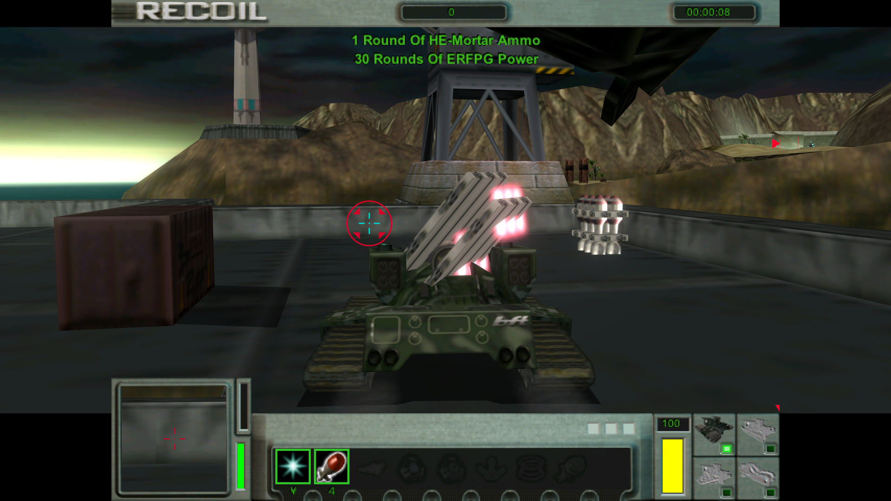
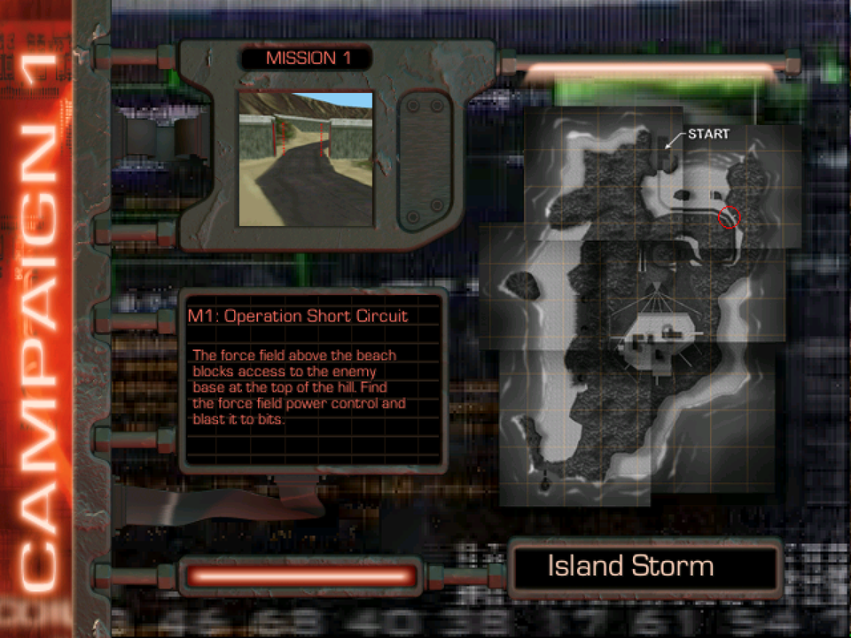

# rustcoil

A native port of **Recoil** (1999) in Rust. The game's own program is recompiled: the
player's `recoil3dfx.exe` (with the MFC and C runtime DLLs it shipped with) is decoded with
[iced-x86], every function is lifted to [Cranelift] IR and compiled to native code when the
game starts, and the Windows, Glide and DirectX functions it calls are implemented in Rust
(OpenGL for the 3D picture, its videos, sound, CD music). No game code or data is part of this
repository or its releases: you need your own copy of the game.

Built with [recomp_kit].



<table>
  <tr>
    <td width="33%"></td>
    <td width="33%"></td>
    <td width="33%"></td>
  </tr>
  <tr>
    <td align="center"><em>Island Storm, widescreen</em></td>
    <td align="center"><em>The mission briefing</em></td>
    <td align="center"><em>The main menu</em></td>
  </tr>
</table>

## Playing

1. Download from the [releases]: `rustcoil-...-windows-x64.zip` for Windows or
   `rustcoil-...-linux-x64.tar.gz` for Linux (x86-64, OpenGL 3.3), and unpack it.
2. Put an image of your Recoil CD next to `rustcoil.exe` (Linux: `rustcoil`) or into the
   `game_files` folder: a `.cue` with its `.bin` files, `.iso`, `.img` (CloneCD) or `.mdf`
   (Alcohol). Or copy into `game_files` the contents of the CD, or your installed game folder.
3. Start `rustcoil.exe` (Linux: `./rustcoil` in its folder). It finds the game and checks the
   version. The CD holds the game only in its installer's archive (`data1.cab`): the first
   start unpacks it itself, as the CD's setup would, into `game_files/Recoil`, and the CD's
   videos into `game_files/Video`. Then it compiles the game (a few seconds; kept in
   `game_files/Recoil/compiled.bin`, later starts are quick). Nothing in `game_files` is ever
   deleted: remove other copies yourself once the game runs.

The US version is supported (`recoil3dfx.exe` with SHA-256 `eba7dab7...3658`); with any
other, or without one, rustcoil says so. The game's music is the CD's audio tracks: they are
played straight from a `.cue`/`.bin` image, so keep that one (an `.iso` has no audio tracks;
the game then runs without music). Without the videos it runs without them.

Messages go to `rustcoil.log` next to the program on Windows, to the terminal on Linux.
Settings and key bindings go to `registry.txt`, saved games to `SavedGames` in
`game_files/Recoil`. On Linux the libraries for sound (ALSA, or PipeWire/PulseAudio through
it) and gamepads (libudev) are needed; every desktop distribution has them.

What is new compared to the original:
- High resolution: drawn at the window's size (or a size of your choice), anti-aliasing,
  texture filtering; fullscreen with Alt+Enter
- Widescreen (Hor+): a mission shows more at the sides, the HUD stays in the middle; menus,
  briefings and videos stay 4:3
- High frame rates: the game's logic runs at 60 steps a second, the pictures in between are
  drawn at your display's refresh rate, smoothly
- A settings menu (F10) with the pages Display, Effects (a soft bloom glow around bright
  things), Keys (the game's own bindings, changed in place) and Gamepad
- Gamepads: the left stick drives, the right stick aims, every button can be bound to any of
  the game's commands. Default (Xbox layout): RT pulse gun, LT advanced weapon, A detonate,
  B center turret, X turret lock, Y view, LB weapon 1, RB missiles, Back map, R3 center
  chassis, D-pad mortars / proximity mines / remote mines / lasers, Start the game's menu.
  The settings menu works by pad too
- The frame rate display (F12)
- No launcher and no CD check: the game starts straight into its menu

## Building

```
cargo build --release
cargo run --release -- path/to/recoil3dfx.exe
```

Without a path it sets up and uses `game_files` (next to rustcoil.exe, else in the current
folder) as above. `cargo test --release` needs no game files. How it works and what is open:
`CLAUDE.md` and `PLAN.md`.

## License

MIT (the code here), except `crates/indeo` (the Indeo 5 video decoder, a port of FFmpeg's):
LGPL-2.1-or-later, see `crates/indeo/COPYING`. The game and its files belong to their owners
and are not part of this project.

[iced-x86]: https://github.com/icedland/iced
[Cranelift]: https://cranelift.dev
[recomp_kit]: https://github.com/RadiatorTwo/recomp_kit
[releases]: https://github.com/RadiatorTwo/rustcoil/releases
