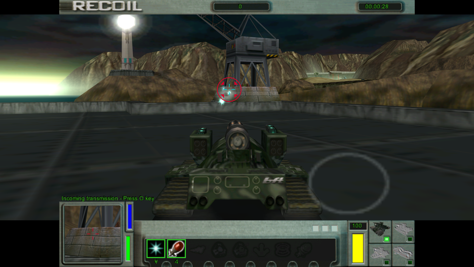
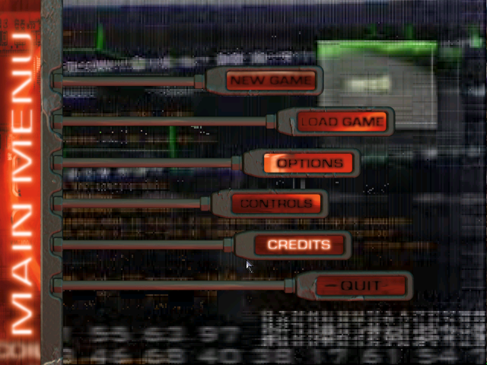

# rustcoil

Play **Recoil** (1999) on today's computers, on Windows and Linux.

rustcoil is not an emulator. It takes your own copy of the game and translates its program
into native code for your computer when you start it. Everything the game expects from an
old Windows PC (3dfx graphics, DirectX, sound, CD music) is rebuilt in Rust. You need your
own copy of the game. Nothing of the game is included here.


<table>
  <tr>
    <td width="33%"></td>
    <td width="33%"></td>
    <td width="33%"></td>
  </tr>
  <tr>
    <td align="center"><em>Island Storm in widescreen</em></td>
    <td align="center"><em>The mission briefing</em></td>
    <td align="center"><em>The main menu</em></td>
  </tr>
</table>

## How to play

1. Download the newest version from the [releases] page. Take the `.zip` for Windows or the
   `.tar.gz` for Linux, and unpack it.
2. Put your Recoil CD next to `rustcoil.exe` or into the `game_files` folder. These work:
   - an image of the CD: `.cue` with its `.bin` files, `.iso`, `.img` or `.mdf`
   - the files of the CD, copied into a folder
   - your installed game folder
3. Start `rustcoil.exe` (on Linux: `./rustcoil`).

The first start takes a moment. rustcoil unpacks the game from the CD by itself, just like the
old setup program did, and prepares it to run. After that the game starts quickly.

rustcoil never deletes anything in `game_files`. Once the game runs, you can remove other
copies yourself.

## Good to know

- **Music:** The music comes from the audio tracks of the CD. Keep the `.cue` image with its
  `.bin` files, then you have music. An `.iso` has no audio tracks, so the game stays silent.
- **Version:** The US version of Recoil works. If you have another one, rustcoil tells you.
- **Your saves and settings** are in `game_files/Recoil`: saved games in `SavedGames`,
  settings and keys in `registry.txt`.
- **Linux** needs the usual libraries for sound and gamepads. Every desktop distribution has
  them.

## What is better than the original

- **Sharp and big:** The game is drawn at the size of your window or screen, with smooth edges
  and filtered textures. Alt+Enter switches to fullscreen.
- **Widescreen:** In missions you see more to the left and right. The HUD stays in the middle.
- **Smooth:** The game runs at its correct speed and still shows as many pictures as your
  screen can display.
- **Settings menu (F10):** picture, a soft glow around bright things, keys and gamepad.
- **Gamepad:** Drive with the left stick, aim with the right stick. Every button can be
  changed. The menus work with the pad too.
- **Straight into the game:** No launcher and no "insert CD" message.
- **Frame rate display:** F12 shows it.

Default gamepad buttons (Xbox layout):

| Button | Action |
|---|---|
| RT | pulse gun |
| LT | advanced weapon |
| A | detonate |
| B | center turret |
| X | turret lock |
| Y | change view |
| LB | weapon 1 |
| RB | missiles |
| Back | map |
| R3 | center chassis |
| D-pad | mortars, proximity mines, remote mines, lasers |
| Start | the game's menu |

## Building it yourself

```
cargo build --release
cargo run --release -- path/to/recoil3dfx.exe
```

Without a path it uses the `game_files` folder, as described above. The tests
(`cargo test --release`) need no game files. How it works inside: `CLAUDE.md` and `PLAN.md`.

Made with [recomp_kit], with [iced-x86] and [Cranelift].

## License

The code here is under the MIT license. The Indeo video decoder in `crates/indeo` is a port of
FFmpeg's and is under the LGPL 2.1 or later (see `crates/indeo/COPYING`). Recoil and its files
belong to their owners and are not part of this project.

[iced-x86]: https://github.com/icedland/iced
[Cranelift]: https://cranelift.dev
[recomp_kit]: https://github.com/RadiatorTwo/recomp_kit
[releases]: https://github.com/RadiatorTwo/rustcoil/releases
